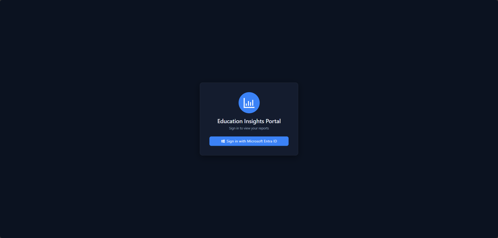
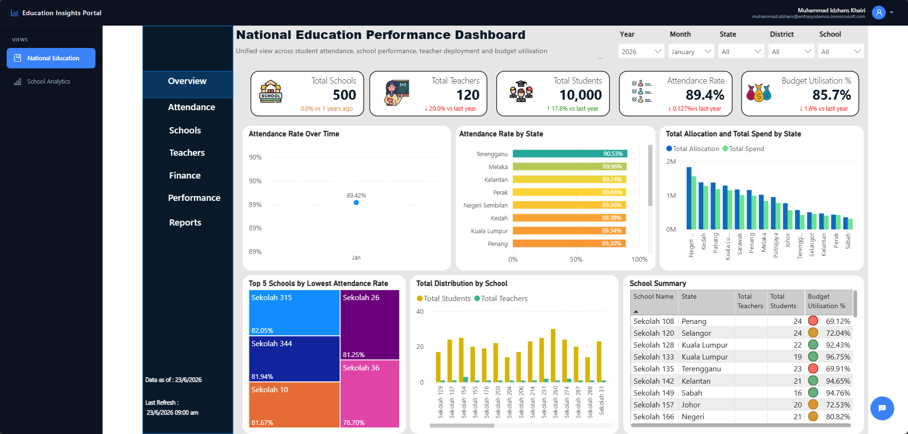
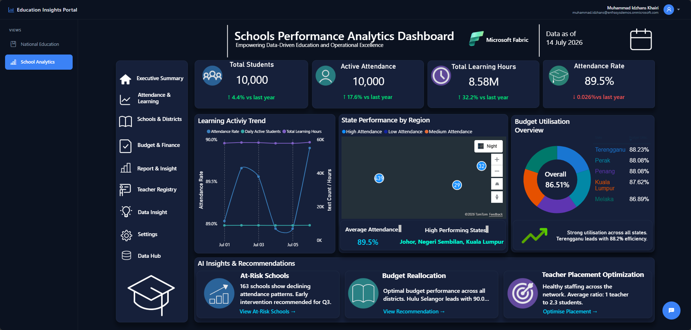
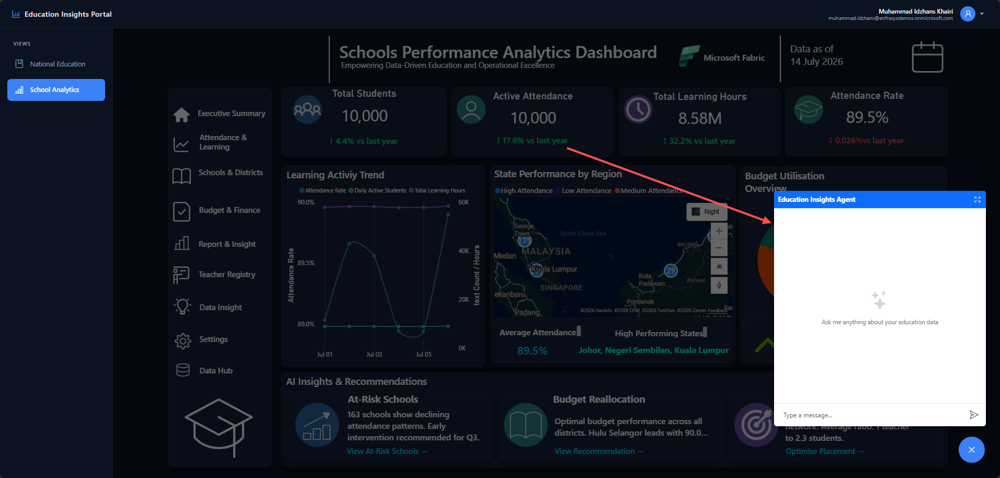
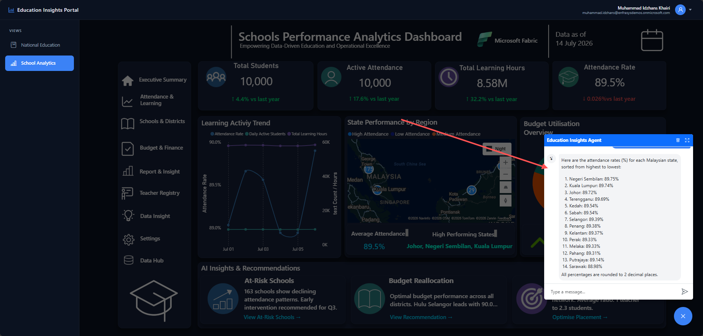
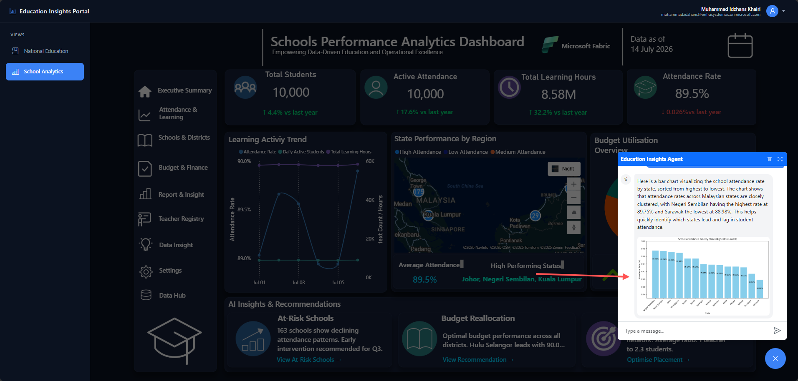
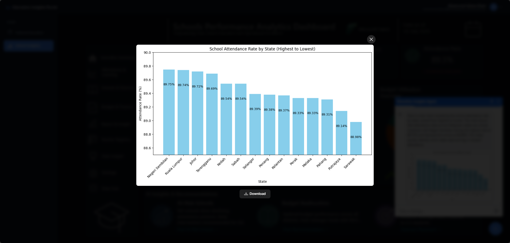

# 🎓 Education Insights Portal

An enterprise-ready web application built with Next.js that embeds multiple Power BI reports and integrates a grounded Generative AI agent powered by Microsoft Foundry and Microsoft Fabric. Users can securely view internal data dashboards, ask contextual questions about the underlying data, and request charts that the agent generates on demand.

## 📖 Overview

This project provides a complete end-to-end web application that bridges the gap between data visualization and conversational AI. Users authenticate securely via Microsoft Entra ID to access the **Education Insights Portal**, which embeds two Power BI dashboards — **National Education** and **School Analytics** — selectable from the sidebar.

While analyzing the reports, users can interact with an AI agent through a chat interface. The agent is hosted in **Microsoft Foundry** and connected to a **Fabric Data Agent**, which grounds every answer in the actual data stored in the `gold_lh` lakehouse inside Microsoft Fabric. When a user explicitly asks for a visualization, the agent uses the **Code Interpreter** to write its own Python code and render a chart, which is displayed inline in the chat.

The entire solution is designed for seamless deployment on Azure Web Apps, utilizing modern web frameworks and enterprise-grade security practices.

> **Note:** This application is built and optimised for **desktop browsers**. A dedicated mobile layout is not implemented.

> **Note on naming:** Microsoft's AI platform has evolved from Azure AI Studio → Azure AI Foundry → **Microsoft Foundry** (current, effective January 2026). The portal still lives at `ai.azure.com` and the Azure resource type remains `Microsoft.CognitiveServices/accounts`. All references to "Foundry" in this document refer to the same platform.

## ✨ Key Features

- **Dual Embedded Power BI Reports:** View two interactive dashboards (National Education & School Analytics) directly within the application using `powerbi-client-react`, switchable via the sidebar.
- **Grounded AI Agent:** A Microsoft Foundry agent connected to a Fabric Data Agent, so every data answer is retrieved from the `gold_lh` lakehouse rather than generated from model memory.
- **On-Demand Chart Generation:** The agent uses the Code Interpreter to write Python/matplotlib code and generate charts — but **only** when the user explicitly asks for a visualization. Charts render inline in the chat with a click-to-enlarge preview and download option.
- **Behaviour-Aware Responses:** The agent classifies each question as *factual*, *reasoning*, or *visualization*. Factual answers relay the Fabric figures unaltered; reasoning answers interpret on top of the retrieved data.
- **Enterprise Security:** Secured by Microsoft Entra ID (via NextAuth). The Fabric Data Agent uses **identity passthrough (On-Behalf-Of)**, so users only ever see data they already have permission to access.
- **Modern Web UI:** Built on Next.js with Ant Design and Bootstrap, using a unified dark navy theme across the login page, app shell, and embedded reports.
- **Polished Chat UX:** Dimmed backdrop on open, click-outside and `ESC` to close (without resetting the conversation thread), and rotating loading phrases while the agent works.

## 🏗️ Architecture


```
User → Entra ID (NextAuth) → Next.js App
                                 ├── Power BI Embedded (2 reports)
                                 └── /api/chat → Microsoft Foundry Agent
                                                   ├── Fabric Data Agent → gold_lh (Lakehouse)
                                                   └── Code Interpreter → matplotlib chart
```

## 📸 Screenshots

### Secure Login
Users authenticate with Microsoft Entra ID before any report or agent access is granted.



### Embedded Dashboards
Two Power BI reports embedded in a single shell, switchable from the sidebar.

| National Education | School Analytics |
| :---: | :---: |
|  |  |

### Insights Agent
Opening the chat dims the report area while keeping the header and sidebar fully visible.



### Grounded Data Answers
Factual questions are answered using figures retrieved directly from the `gold_lh` lakehouse in Microsoft Fabric.



### On-Demand Chart Generation
When a visualization is explicitly requested, the agent writes its own Python code via the Code Interpreter and the chart renders inline in the chat.



### Chart Preview
Clicking any generated chart opens an enlarged preview with a download option.



## 🗄️ Data Model

The agent is grounded on the `gold_lh` lakehouse in Microsoft Fabric. `SchoolID` is the primary linking column across all tables.

| Table | Key Columns | Purpose |
| --- | --- | --- |
| `schools_schoolregistry` | `SchoolID`, `SchoolName`, `State`, `District`, `Registered Date` | Master reference list of all schools |
| `students_attendance` | `StudentID`, `SchoolID`, `Date`, `Attendance` | Daily student attendance records |
| `teachers_schoolregistry` | `TeacherID`, `SchoolID`, `Subject`, `JoinDate` | Registry of teachers and their subjects |
| `budget_finance` | `SchoolID`, `Date`, `Allocation`, `Spend`, `budget_utilization` | Budget allocation and spending per school |

## 💻 Tech Stack

- **Frontend & API**: [Next.js](https://nextjs.org/) (App Router, TypeScript)
- **UI Components**: Ant Design (antd), Bootstrap 5 & Bootstrap Icons
- **Authentication**: NextAuth.js (Microsoft Entra ID)
- **Data Visualization**: `powerbi-client-react`
- **AI Orchestration**: Microsoft Foundry (`@azure/ai-projects` SDK, Responses API)
- **Data Grounding**: Microsoft Fabric Data Agent (preview) over a Lakehouse
- **Chart Generation**: Foundry Code Interpreter (Python / matplotlib)
- **Markdown Rendering**: `react-markdown` with `remark-gfm`
- **Deployment**: Azure App Service (Linux Web App)

## 📋 Prerequisites

Before setting up the project locally, ensure you have the following:

- [Node.js](https://nodejs.org/en/) (v18 or higher)
- [Azure CLI](https://learn.microsoft.com/en-us/cli/azure/install-azure-cli) (for local Azure authentication)
- An active Azure Subscription with a **Microsoft Foundry** project and a published agent.
- A **Microsoft Fabric** workspace containing the `gold_lh` lakehouse, plus a **published Fabric Data Agent**.
  - Requires a paid **F2 or higher** Fabric capacity, or a **Power BI Premium P1 or higher** capacity with Fabric enabled.
  - The Fabric data agent tenant setting, plus **cross-geo processing** and **cross-geo storing for AI**, must be enabled by a Fabric admin.
- A Power BI Pro/Premium license with two accessible reports in the same workspace.
- An App Registration in Microsoft Entra ID for authentication.

### Required roles and access

- Developers and end users need at least the **Foundry User** Azure RBAC role on the Foundry resource.
  *(Foundry RBAC roles were recently renamed — `Foundry User` was previously `Azure AI User`. You may still see the old names in some places.)*
- Developers and end users need at least **READ** access to the Fabric Data Agent, and read access to the underlying lakehouse data.
- **Model quota matters.** This project runs on a `gpt-4.1` deployment. GPT-5.x family models may return `insufficient quota` errors depending on your subscription's allocation — verify quota in the Foundry portal before switching models.

> ⚠️ **Important:** Only **one** Fabric Data Agent can be attached as a knowledge source to a Foundry agent. Also, the model selected during Foundry agent setup is used only for orchestration and response generation — it does **not** change the model the Fabric Data Agent uses for its natural-language-to-SQL translation.

## 🤖 Agent Configuration

### Foundry Agent (`education-insights-agent`)

- **Web Search:** Disabled (all answers must be grounded in Fabric data).
- **Code Interpreter:** Enabled — used *only* when the user explicitly requests a chart, graph, plot, or visualization.
- **Knowledge source:** The Fabric Data Agent, attached as a tool.
- **Instructions:** Classify each request as *factual lookup*, *reasoning/analysis*, or *visualization*; always query the Fabric Data Agent first; never fabricate figures.

Agents are **versioned**. The version is referenced from the environment (see below), so publishing a new version only requires an environment variable change — no code edit.

### Fabric Data Agent (`education-insights-dataAgent`)

Configured with AI instructions describing the schema, join keys, and metric definitions (attendance rate, budget utilisation, teacher-to-student ratio), plus few-shot example queries covering the common query shapes (rate, ratio, top-N, trend, group-by).

## ⚙️ Environment Variables

Create a `.env.local` file in the project root and configure the following variables.

```env
# Microsoft Foundry Settings
FOUNDRY_PROJECT_ENDPOINT="https://<your-resource-name>.services.ai.azure.com/api/projects/<your-project-name>"

# Agent reference in "name:version" format — e.g. "education-insights-agent:4"
AZURE_OPENAI_AGENT_ID="<your-agent-name>:<version>"

# Entra ID Authentication
AUTH_MICROSOFT_ENTRA_ID_ID="<your-entra-id-client-id>"
AUTH_MICROSOFT_ENTRA_ID_SECRET="<your-entra-id-client-secret>"
AUTH_MICROSOFT_ENTRA_ID_TENANT_ID="<your-entra-id-tenant-id>"
AUTH_MICROSOFT_ENTRA_ID_ISSUER="https://login.microsoftonline.com/<your-entra-id-tenant-id>/v2.0"
AUTH_SECRET="<your-generated-nextauth-secret>"
AUTH_URL="http://localhost:3000"

# Power BI Related
NEXT_PUBLIC_POWERBI_GROUP_ID="<your-powerbi-workspace-group-id>"
NEXT_PUBLIC_POWERBI_REPORT_ID_AQEELA="<national-education-report-id>"
NEXT_PUBLIC_POWERBI_REPORT_ID_ARIFF="<school-analytics-report-id>"
```

### Notes on environment variables

- **`AZURE_OPENAI_AGENT_ID` uses a `name:version` format.** The route splits on `:` to derive the agent name and version, so you only change this one line when publishing a new agent version.
- **`NEXT_PUBLIC_` variables are baked in at build time.** They must be present during the build step (not just at runtime), so set them in `.env.production` or as build-time variables in your CI pipeline.
- **Authentication uses `DefaultAzureCredential`**, not an API key. Locally this resolves to your Azure CLI login; in Azure it resolves to the Web App's managed identity. There is no `AZURE_OPENAI_API_KEY` requirement.
- **No model deployment name is required.** The app calls the managed Foundry agent directly via `agent_reference`, and the agent carries its own model, instructions, and tools. A deployment name is only needed if you reintroduce a route that calls a raw model directly.

## 🚀 Local Setup

**1. Clone the repository:**
```cmd
git clone <your-repository-url>
```
```cmd
cd <your-project-folder>
```

**2. Install dependencies**
```cmd
npm install
```

**3. Authenticate with Azure CLI:**
To test Foundry and Fabric connections locally, log in to the Azure CLI using an account that has access to your resources.
```cmd
az login
```

> ⚠️ **Important:** Because the Fabric Data Agent uses **identity passthrough**, the account you log in with must have read access to the Fabric workspace and the `gold_lh` lakehouse. If the agent replies that it *"can't access the data source,"* the most common cause is an expired CLI token or an account without Fabric access — run `az login` again and confirm workspace permissions.

**4. Run the development server:**
```cmd
npm run dev
```

**5. Access the application:**
Open [http://localhost:3000](http://localhost:3000) in your web browser.

## ☁️ Deployment to Azure Web App

Deploying this application to Azure Web App requires a specific set of configurations to handle the Next.js standalone build properly.

**1. Create the Azure Web App:**
In the Azure Portal, create a new Web App with the following settings:
- **Publish:** Code
- **Runtime stack:** Node 22 LTS
- **Operating System:** Linux
- **Region:** Choose your preferred region
- **Pricing Plan:** Select your appropriate Linux plan

**2. Configure Deployment:**
- During creation or via the **Deployment Center** tab, enable **Continuous Deployment**.
- Select your GitHub account and choose the repository and branch.
- Once finished, Azure will automatically generate a `.github/workflows` folder with a `.yml` file in your repository.

**3. Edit the GitHub Actions Workflow:**
Modify the generated `.yml` file to properly handle the Next.js standalone build structure. Ensure your build step includes the logic to flatten the standalone directory and copy the necessary static files (e.g., `public`, `.next/static`).

**4. Configure Environment Variables:**
In the Azure Portal, navigate to your Web App's **Settings** → **Environment variables**. Add all the keys from your `.env.local` file.
- *Note: Enter the variable values exactly as they are, without surrounding quotes (`""`).*
- Set `AUTH_URL` to your deployed URL (e.g. `https://<your-webapp-name>.azurewebsites.net`), **not** `localhost:3000`.
- Remember that `NEXT_PUBLIC_` variables must be available at **build time**, so they also need to be set in your GitHub Actions workflow or `.env.production`.

**5. Update the Startup Command:**
To tell Azure how to start the standalone Next.js server:
- Navigate to **Settings** → **Configuration** → **Stack Settings** tab.
- Locate the **Startup Command** field.
- Enter exactly: `node server.js`
- Save the changes.

**6. Enable Managed Identity and Grant Foundry Access:**
Because the app authenticates with `DefaultAzureCredential`, the deployed Web App needs its own identity:
- Go to your Web App → **Settings** → **Identity** → enable **System assigned** managed identity.
- On your Foundry resource, assign the managed identity the **Foundry User** role (previously named *Azure AI User*).

**7. Configure Fabric Access:**
- In your Fabric workspace (the one containing `gold_lh`), grant access so the calling identity can read the lakehouse and the Fabric Data Agent.
- If you are using a **service principal or managed identity** rather than a signed-in user, a Fabric admin must enable the relevant tenant setting allowing service principals to use Fabric APIs, and the principal must be added to the workspace.

> ⚠️ **Known consideration:** The Fabric Data Agent tool is in **preview** and uses **identity passthrough (On-Behalf-Of)** — queries run as the *end user's* identity. This means a setup that works locally under your `az login` session may behave differently once deployed. Verify end-to-end in the deployed environment before a demo, and confirm which identity is actually reaching Fabric.

**8. Configure Entra ID Authentication Redirects:**
Ensure your Microsoft Entra ID App Registration is updated with the correct Web App URL:
- Go to your App Registration → **Authentication**.
- Add the redirect URI: `https://<your-webapp-name>.azurewebsites.net/api/auth/callback/microsoft-entra-id`

**9. Monitor and Access:**
- Check the **Log stream** under the **Monitoring** section to ensure the application starts correctly.
- Once the logs confirm a successful startup, navigate to the **Overview** page and click the **Default domain** link to open your deployed application.

## 🖱️ Usage Guide

**1. Secure Login**
Navigate to your deployed Web App URL. Click **Sign in with Microsoft Entra ID** to authenticate.

**2. Switch Between Dashboards**
Use the sidebar to switch between the **National Education** and **School Analytics** dashboards.

**3. Open the Insights Agent**
Click the floating chat button in the bottom-right corner. The chat opens as a pane over the report, and the dashboard area dims so the chat stays the focus — the header and sidebar remain fully visible. Use the maximize icon in the chat header to expand it to a larger view.

**4. Close the Chat (Thread Preserved)**
Close the chat by clicking the floating button again, clicking anywhere outside the chat panel, or pressing **`ESC`**. Your conversation history and thread are **preserved** — reopening continues the same conversation.

**5. Ask Questions**
Type your question and press Enter. Rotating loading phrases display while the agent queries Fabric. Responses are rendered as formatted markdown.

**6. Request a Chart**
Explicitly ask for a visualization (e.g. *"Generate a bar chart of attendance rate by state"*). The agent retrieves the data from Fabric, writes Python code via the Code Interpreter, and the chart appears **inline** in the chat. Click any chart to open an enlarged preview with a download option.

**7. Clear Chat**
Click the trash icon in the chat header to reset the conversation and start a fresh thread.

## 🧪 Suggested Test Questions

Use these to validate the agent across its three behaviour modes:

| Type | Question | What it demonstrates |
| --- | --- | --- |
| Factual (multi-row) | *"What is the attendance rate by state?"* | Retrieving and returning a full breakdown across multiple records |
| Factual (single value) | *"How many schools do we have in total?"* | Returning a specific, verifiable figure from the data |
| Visualization | *"Generate a bar chart of attendance rate by state."* | Chart generation via the Code Interpreter, rendered inline |
| Reasoning | *"Which states should we prioritise for attendance support, and why?"* | Interpreting and recommending on top of grounded data |
| Guardrail | *"What is the average teacher salary?"* | Correctly declining — salary data does not exist in the schema |

## 🛠️ Troubleshooting

| Symptom | Likely cause & fix |
| --- | --- |
| Agent says it *"can't access the data source"* | Expired `az login` token, or the calling identity lacks Fabric workspace / lakehouse access. Re-run `az login` and verify permissions. |
| `insufficient quota` when calling the agent | The selected model deployment has no quota on your subscription. Use a model with confirmed quota (e.g. `gpt-4.1`). |
| White seam or letterboxing around a report | Set the embed `background` setting to `Transparent` (`1`) and ensure the container background matches the report theme. |
| Chart returns a broken link instead of an image | The Code Interpreter output must be retrieved as a container file and converted to a base64 data URL before rendering inline. |
| Empty Code Interpreter calls in the response log | The agent could not retrieve data from Fabric, so it had nothing to plot. Check the Fabric connection and identity first. |

## ⚠️ Known Limitations

- **Desktop only.** The application is designed for desktop browsers; no mobile or tablet layout is implemented.
- **Fabric Data Agent is in preview.** Behaviour, connection lifetime, and token handling may change.
- **One data agent per Foundry agent.** Only a single Fabric Data Agent can be attached as a knowledge source.
- **Model quota dependent.** Agent responses will fail if the underlying model deployment has no available quota.

---

<div align="center">
  <em>Developed by <strong>Muhammad Idzhans Khairi</strong> for <strong>Enfrasys Solutions Sdn Bhd<strong></em>
</div>
